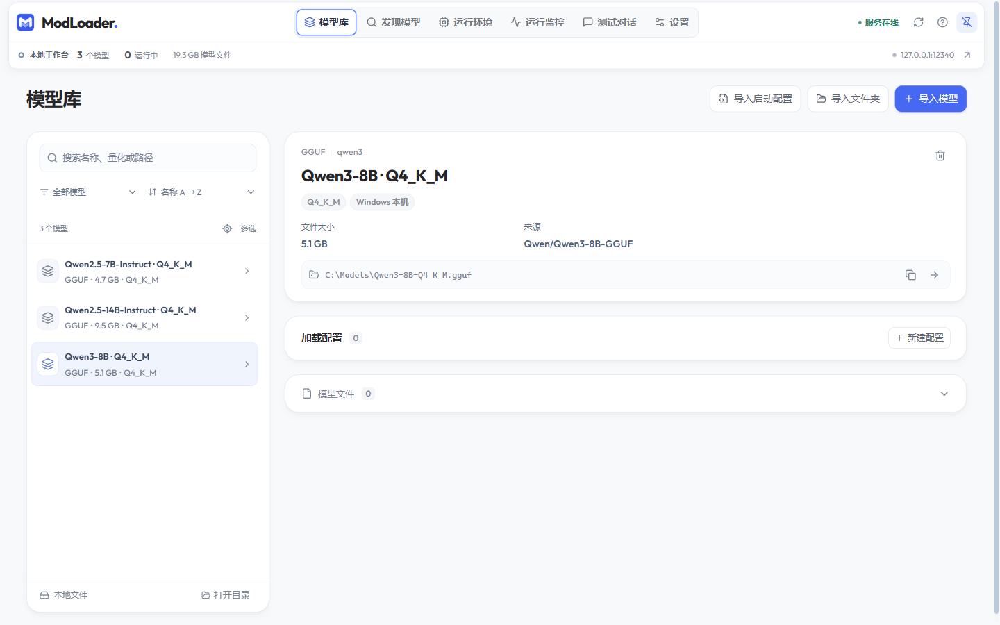
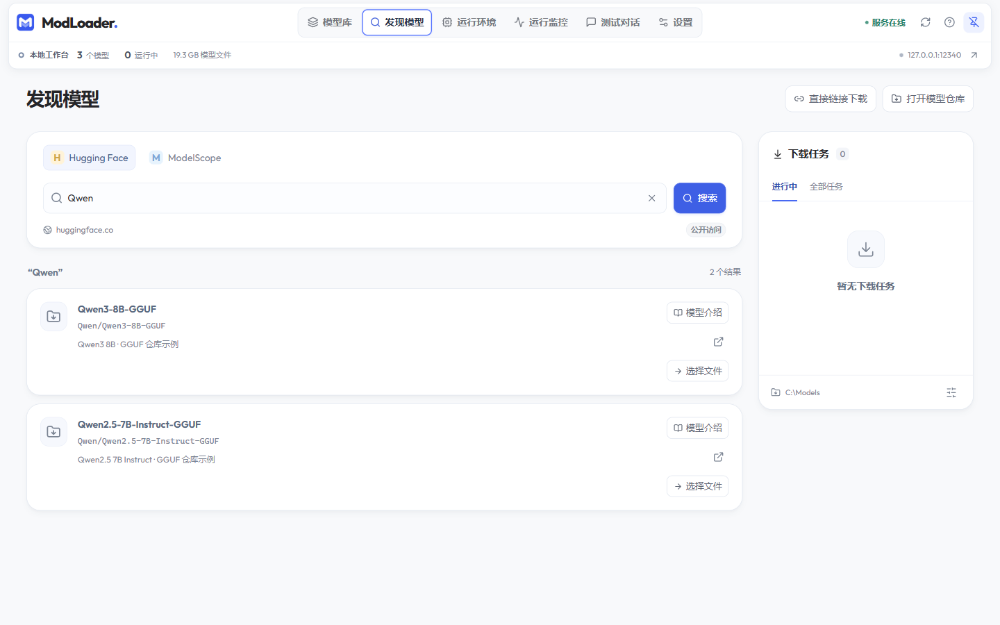
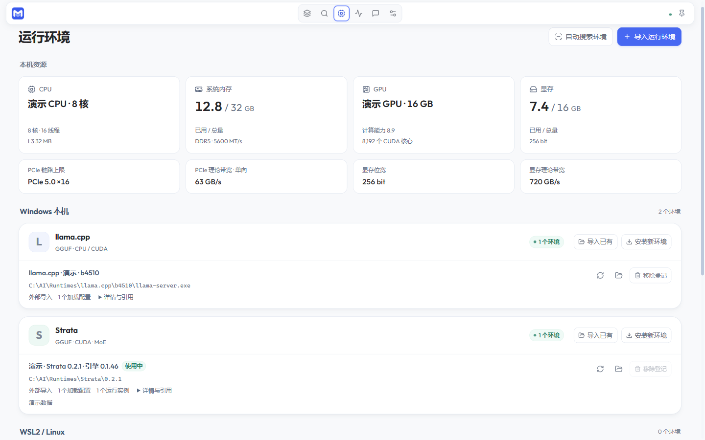
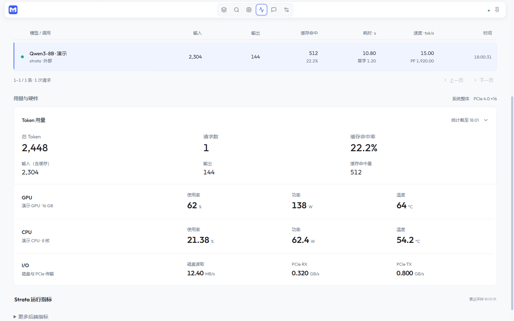
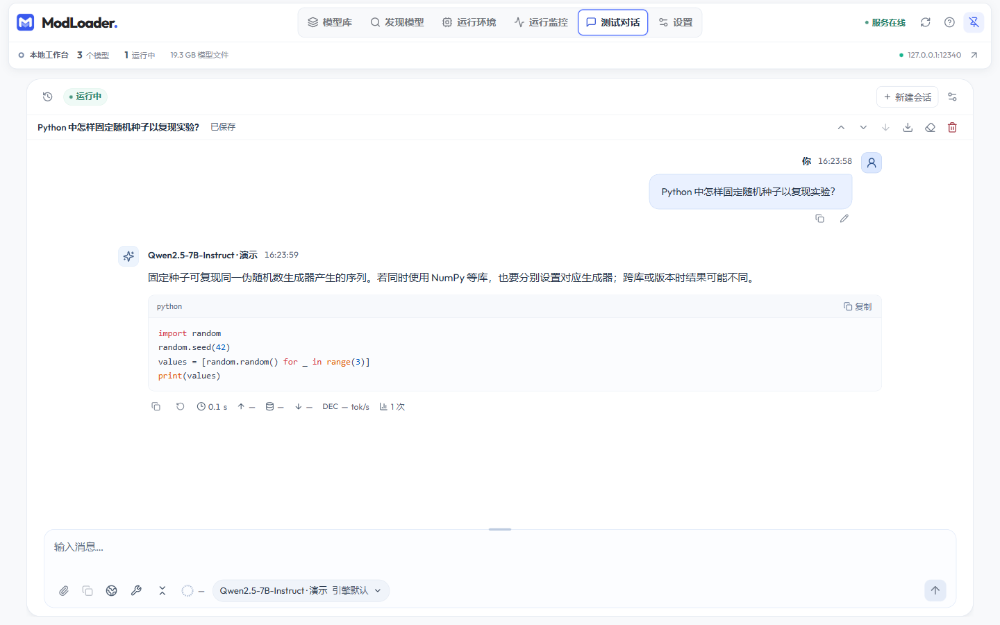

# ModLoader

Windows 本地大模型管理与运行工具。统一管理模型文件、运行环境和加载配置，提供内置对话、本地 API 与运行监控。

## 功能

- **模型管理**：从 Hugging Face、ModelScope 或直链下载模型，导入本地 GGUF、Hugging Face 模型目录和 `.ninfer` 文件。
- **环境管理**：检测和导入已有环境，也可独立安装、更新运行环境，并切换关联配置。
- **加载配置**：同一模型保存多套环境与参数组合，复用权重和配套资源，分别设置 API 模型名称。
- **内置对话**：流式输出、会话历史、图片与文档附件、内容预览；可选联网检索和本地工具。
- **统一 API**：通过 OpenAI 兼容的 Chat Completions 接口调用已加载模型。
- **运行监控**：查看生成速度、请求记录、用量和硬件指标，支持独立监控小窗。

## 后端

- **Windows**：llama.cpp、Strata、Transformers。
- **WSL2**：vLLM、SGLang、NInfer、SparkInfer。

也支持为已有的 OpenAI 兼容服务配置自定义引擎启动模板。各后端的模型格式、硬件要求和特性见[运行环境与模型格式](docs/backends.md)。

## 获取与启动

**[下载 Windows x64 便携版](https://github.com/RenaKana/ModLoader/releases/latest)**

在 Releases 中下载 `ModLoader-v0.1.0-windows-x64.zip`，完整解压到可写目录后运行 `ModLoader.exe`。支持 Windows 10 / 11（64 位），无需另行安装 Python 或 Node.js。模型和运行环境可在应用内下载、安装或导入。

源码开发和自行打包见[开发与构建](docs/development.md)。

## 界面预览

截图使用演示数据。

### 模型库

### 发现模型

### 运行环境

### 运行监控

### 测试对话

## 快速开始

1. 在“发现模型”下载模型，或从“模型库”导入本地文件、模型目录或已有启动配置。
2. 在“运行环境”安装或导入与模型匹配的后端环境。
3. 为模型“新建配置”，选择运行后端和环境，设置“API 模型名称”，保存后点击“加载模型”。
4. 状态变为“运行中”后，进入“测试对话”使用，或接入外部客户端。

详细操作见[使用指南](docs/usage.md)。

## API 接入

在“设置 → 本地 API”复制 Base URL 和 API Key，客户端的模型名称填写加载配置中的“API 模型名称”。

提供 `GET /v1/models` 和 `POST /v1/chat/completions`，支持流式响应，仅监听 `127.0.0.1`。具体接入方式见[连接其他软件](docs/usage.md#连接其他软件)。

## 使用要点

- 模型导入只登记路径，不复制权重；原文件及分片、配套资源需保留在原位置。
- 联网功能需在“设置 → 联网服务”配置；不使用时可在对话输入区关闭“联网搜索”。
- 关闭主窗口默认进入托盘，模型继续运行。完全退出使用托盘菜单“退出并停止模型”。

加载或安装失败时，先查看对应配置的“日志”或任务详情；常见问题见[排错顺序](docs/usage.md#排错顺序)。

## 文档与参与

- [使用指南](docs/usage.md)：模型与环境管理、对话、联网、监控和数据保存。
- [运行环境与模型格式](docs/backends.md)：后端适配、WSL2、高级参数和自定义引擎。
- [开发与构建](docs/development.md)：源码启动、测试和桌面打包。
- [反馈与贡献](CONTRIBUTING.md) · [安全报告](SECURITY.md)

## 许可

ModLoader 源码采用 [MIT 许可](LICENSE)。第三方组件、运行环境及模型分别遵循各自的许可，见[第三方声明](THIRD_PARTY_NOTICES.md)。
